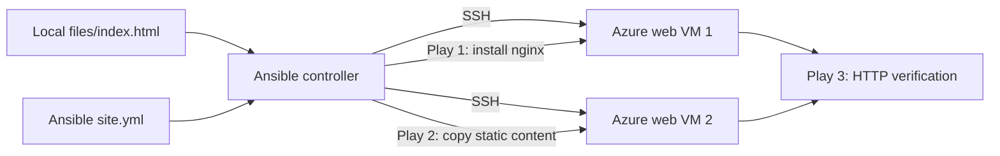

# Azure Multi-Play Static Website Deployment with Ansible

**DevOps Micro Internship (DMI), Cohort 2 · Week 12 · Assignment 3**

**Author:** Ibrahim Ahmed Abiodun
**Platform:** Microsoft Azure
**Scope:** Documentation and evidence of the completed training lab

Nginx static website deployment and HTTP verification across two Azure web VMs using a three-play Ansible playbook.

## Project overview

This project documents the workflow and outcomes reported in the Week 12 assignment. **The packaged ZIP contains documentation, diagrams and original Word screenshots—not executable source code.** Add the documentation to the corresponding existing local project, retaining its actual Terraform, Ansible and application files. Commands below describe the recorded lab and must be adapted before any redeployment.

## Tools and technologies

`Ansible Playbooks`, `Ansible copy module`, `Ansible uri module`, `Terraform`, `Nginx`, `SSH`

## Architecture

See [architecture diagram](diagrams/architecture.mmd) and [architecture notes](docs/ARCHITECTURE.md).

## Implementation summary

- **Prepare the project:** Create `inventory.ini`, `site.yml`, `README.md` and `files/index.html` in the local static website project.
- **Prepare content:** The recorded lab downloaded `index.html` from the upstream Azure Static Website project; preserve attribution if reusing it.
- **Write the multi-play playbook:** Play 1 installs/configures Nginx; Play 2 deploys static HTML using `copy`; Play 3 checks HTTP service availability with `uri`.
- **Run and verify:** Activate the Ansible environment and run `ansible-playbook -i inventory.ini site.yml`. Test both web server URLs.

## Evidence from the original Week 12 report

#### Multi-play playbook structure

#### Successful playbook recap

#### Webpage in browser - first verification

[View all 9 original screenshots](screenshots/README.md).

## Technical documentation

- [Deployment / setup procedure](docs/DEPLOYMENT.md)
- [Architecture and components](docs/ARCHITECTURE.md)
- [Verification and results](docs/VERIFICATION.md)
- [Troubleshooting](docs/TROUBLESHOOTING.md)
- [Security and GitHub publication](docs/SECURITY.md)

## Skills demonstrated

- Multi-play Ansible orchestration
- Static website deployment
- Inventory targeting
- Idempotent configuration
- Nginx provisioning
- Automated HTTP verification

## Source attribution

Training application/content source: [https://github.com/pravinmishraaws/Azure-Static-Website](https://github.com/pravinmishraaws/Azure-Static-Website). The upstream application is credited to its original maintainer; this repository documents the author’s cloud infrastructure, configuration and deployment work.

## Scope and limitations

The evidence is from a historical training environment; endpoints and public IP addresses from the report may no longer resolve or belong to the author. The report does not independently establish HTTPS, continuous monitoring, automated rollback, or production security hardening. Do not treat the lab as an actively maintained production service.

**Important:** Before publishing, review every screenshot and all local project files for confidential information; see `docs/SECURITY.md`.
