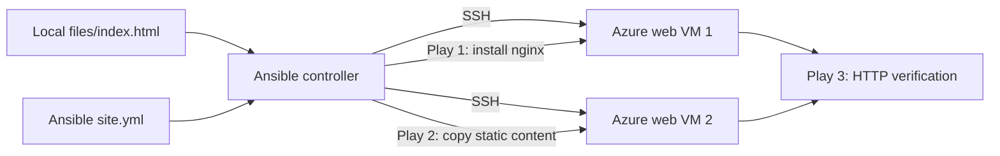

# Architecture and responsibility boundaries

## Architecture diagram

The diagram is a **simplified representation derived from the written assignment**, not a precise discovery of existing cloud resources or production networking. It should not imply additional load balancers, private subnets, HTTPS, or high availability unless supported by the user's actual code.

## Key components

- **Prepare the project** — Create `inventory.ini`, `site.yml`, `README.md` and `files/index.html` in the local static website project.
- **Prepare content** — The recorded lab downloaded `index.html` from the upstream Azure Static Website project; preserve attribution if reusing it.
- **Write the multi-play playbook** — Play 1 installs/configures Nginx; Play 2 deploys static HTML using `copy`; Play 3 checks HTTP service availability with `uri`.
- **Run and verify** — Activate the Ansible environment and run `ansible-playbook -i inventory.ini site.yml`. Test both web server URLs.
