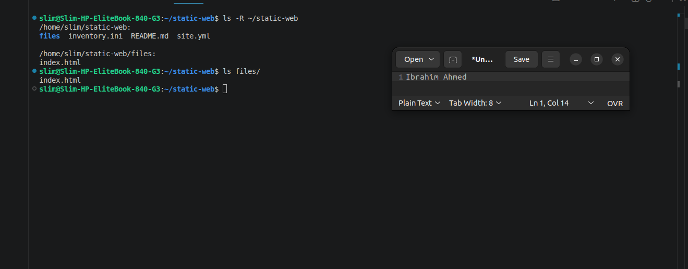
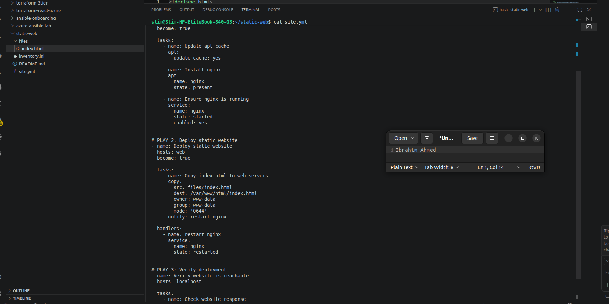
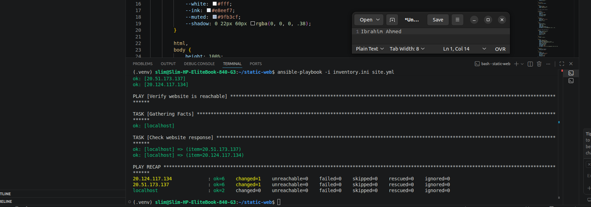
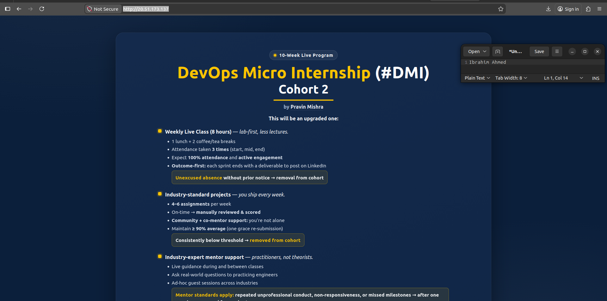
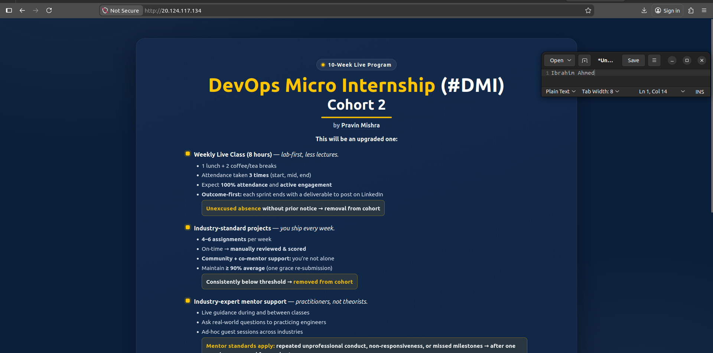
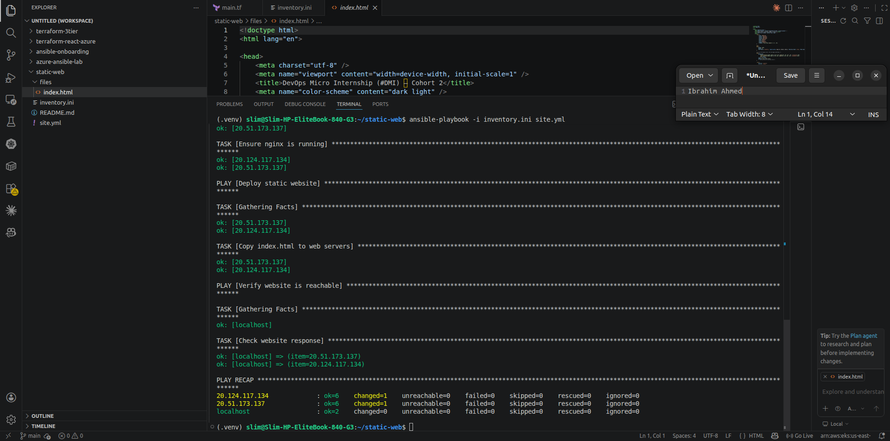
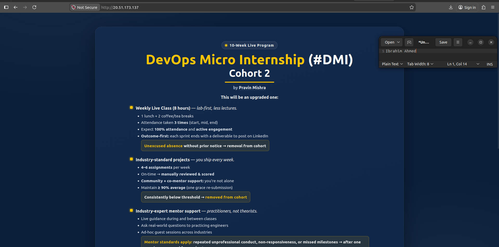

# Original screenshots — Assignment 3

The 9 images below were extracted **directly from the uploaded Week 12 Word report**. Their original image bytes and dimensions are preserved. Evidence documents historical lab execution, **not a currently running service**.

Before publishing, manually inspect the images for email addresses, cloud account/subscription IDs, live credentials, private keys and personal identifiers. Redact sensitive details while preserving the technical proof and required visible name.

### 01. Project working directory

Original embedded Word image: 1319 × 517 pixels.

### 02. Multi-play playbook structure

Original embedded Word image: 1754 × 878 pixels.

### 03. Successful playbook recap

Original embedded Word image: 1700 × 598 pixels.

### 04. Webpage in browser - first verification

Original embedded Word image: 1920 × 953 pixels.

### 05. Webpage in browser - second verification

Original embedded Word image: 1920 × 953 pixels.

### 06. Ansible playbook verification

Original embedded Word image: 1920 × 953 pixels.

### 07. Website browser screenshot

Original embedded Word image: 1920 × 953 pixels.

### 08. Second web VM verification

Original embedded Word image: 1920 × 953 pixels.

### 09. Playbook result evidence

Original embedded Word image: 1920 × 953 pixels.
